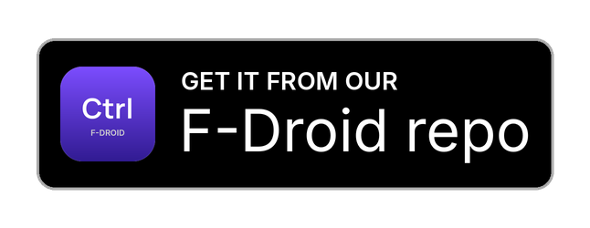

# TrueCtrl

**Monitor and manage your TrueNAS server from your phone.**

[](https://github.com/VoidedKN0X/TrueCtrl/releases/latest)  [](LICENSE)  [](https://github.com/sponsors/VoidedKN0X)

TrueCtrl is an Android app for [TrueNAS](https://www.truenas.com/): a fast, touch-first alternative to the web UI for keeping an eye on storage health, protecting your data and handling day-to-day management.

Part of the [Ctrl series](#the-ctrl-series) by VKNXWorks.

<a href="https://apps.obtainium.imranr.dev/redirect?r=obtainium://add/https://github.com/VoidedKN0X/TrueCtrl"></a> <a href="https://voidedkn0x.github.io/CtrlF-Droid/"></a>

## Features

- **Overview** of your server, with an attention list for alerts, unhealthy or full pools, failing disks, overdue scrubs, failed or stale backups, stopped services, crashed apps and pending updates, a system card, live CPU, memory and network graphs, and your pools
- **Alerts** that update live, with dismiss and restore
- **Storage**: pools with their health, space and layout, and scrubs you can start, pause, resume and stop with live progress
- **Datasets** as a tree: space, quota, compression, encryption and more. Create child datasets with the TrueNAS presets, edit quotas and comments, lock and unlock encrypted datasets, and delete with a preview of everything that goes with it
- **Disks** with temperatures, temperature and speed graphs, and SMART health (self-tests and attributes on TrueNAS 25.04)
- **Protection**: periodic snapshot, replication, cloud sync, rsync and scrub tasks with their schedule, last and next run, and the age of the last good backup. Run tasks now, stop a cloud sync, turn snapshot and scrub tasks on and off
- **Snapshots**: browse per dataset, take, delete one or many, roll back and clone
- **Sharing**: SMB and NFS shares (turn them on and off), who's connected over SMB, and the services behind them (start, stop, restart, start on boot)
- **System**: apps (start, stop, redeploy, upgrade, open their web UI, live container logs), jobs with live progress, TrueNAS updates, network interfaces with live traffic, the TrueNAS shell, and reboot and shutdown
- **Notifications**: background checks every 15 to 120 minutes, and TrueNAS alerts pushed within seconds through **[ntfy](https://f-droid.org/packages/io.heckel.ntfy/)** and your own ntfy server (TrueCtrl can set it up on TrueNAS for you), with the background checks as a fallback
- **Widgets and a Quick Settings tile** with pool health and usage, the number of active alerts, and whether anything needs attention
- **ProxCtrl link**: if TrueNAS runs as a Proxmox VM, open that VM in [ProxCtrl](https://github.com/VoidedKN0X/ProxCtrl) straight from TrueCtrl, for example to start it again after a shutdown
- **Several servers**, signed in with an API key or a password (two-factor codes work too), with a list of what each sign-in is allowed to do
- **Works offline**: the last known state stays on screen, marked as out of date, when TrueNAS can't be reached
- **Safe by design**: read-only mode that blocks every change at the connection level, confirmations for anything disruptive (typing the dataset path or hostname for the most dangerous ones), certificate pinning, an optional fingerprint or screen-lock app lock, screenshots blocked wherever you type keys, passwords, passphrases or use the shell, a blank preview in recent apps, API keys and passwords encrypted with the Android Keystore, and dataset passphrases that are never saved

## Screenshots

Coming soon.

## Requirements

- Android 13 or newer, on a 64-bit ARM phone (nearly every phone from the last several years)
- TrueNAS 25.04 or newer (Community Edition). TrueCtrl only uses the JSON-RPC WebSocket API; the old REST API isn't used, so older versions aren't supported (see [supported versions](#supported-truenas-versions))
- HTTPS on your TrueNAS (TrueNAS only accepts API keys over a secure connection). A self-signed certificate is fine: TrueCtrl shows its fingerprint the first time and pins it
- **Google-free and de-Googled:** no Google Play services, Firebase or other Google services, and the app never contacts Google. It works the same on de-Googled phones (GrapheneOS, CalyxOS, /e/OS, LineageOS without Google apps).
- Optional: the [ntfy](https://f-droid.org/packages/io.heckel.ntfy/) app, for instant push alerts

## Install

1. Download the latest `.apk` file from the [Releases page](https://github.com/VoidedKN0X/TrueCtrl/releases/latest).
2. Open it on your phone. Android may ask you to allow installing apps from your browser or file manager.
3. Updates install over the old version. Your settings and login are kept.

**Automatic updates:** on your phone, tap one of the buttons below.

- **Obtainium:** install [Obtainium](https://github.com/ImranR98/Obtainium) first. The button adds TrueCtrl and installs every new release for you.
- **F-Droid:** adds the [CtrlF-Droid repo](https://voidedkn0x.github.io/CtrlF-Droid/) to F-Droid, Droid-ify or Neo Store, with every Ctrl app and automatic updates.

<a href="https://apps.obtainium.imranr.dev/redirect?r=obtainium://add/https://github.com/VoidedKN0X/TrueCtrl"></a> <a href="https://voidedkn0x.github.io/CtrlF-Droid/"></a>

If the Obtainium button doesn't open the app, add `https://github.com/VoidedKN0X/TrueCtrl` in Obtainium by hand.

## Getting started

1. [Give TrueCtrl its own user and API key](#give-truectrl-its-own-user-and-api-key) on your TrueNAS.
2. Open TrueCtrl and enter your TrueNAS **Address**, like `192.168.1.9` or `https://nas.example.com`. TrueCtrl only connects over HTTPS.
3. Choose **API key** and enter the username and key, or choose **Password** to sign in with your TrueNAS login. Two-factor codes work too, but you'll need a new code each time TrueCtrl reconnects, so an API key is easier.
4. Tap **Connect**. If your TrueNAS uses the self-signed certificate it created on install, compare the fingerprint TrueCtrl shows with your server's, then tap **Trust**.
5. TrueCtrl shows what your sign-in is allowed to do. Tap **Continue**.

## Give TrueCtrl its own user and API key

TrueCtrl works best with its own TrueNAS user and an API key that can only do what you need. API keys belong to a user and can never do more than that user.

**1. Create the user.** In the TrueNAS web UI, go to **Credentials → Users → Add**. Name it `truectrl`, give it no password login and no shell, and pick its access level:

- **Monitoring only:** add the user to the group `truenas_readonly_administrators`. That's the built-in **Read-only Administrator** privilege: TrueCtrl can see everything but change nothing.
- **Monitoring and day-to-day actions:** create your own privilege under **Credentials → Groups → Privileges → Add** with the roles below, attached to a group the `truectrl` user is in. Start from `READONLY_ADMIN` and add only the write roles for the actions you want.
- **Everything:** add the user to `builtin_administrators` (Full Admin). Only do this if you need it: rebooting and shutting down need it, and on TrueNAS 25.04 SMART self-tests, snapshot rollback and clone.

**2. Create the API key.** Go to **Credentials → Users**, open the `truectrl` user (or the API Keys page from your user menu), choose **Add API Key** for that user, and copy the key. TrueNAS shows it **once**. In TrueCtrl, enter the username `truectrl` and that key.

**What each role is for:**

| Role | Used for |
| --- | --- |
| `READONLY_ADMIN` | Everything TrueCtrl shows: the Overview, alerts, pools, datasets, disks, graphs, tasks, snapshots, shares, services, apps, jobs, updates and network |
| `POOL_WRITE` | Starting, pausing, resuming and stopping scrubs |
| `POOL_SCRUB_WRITE` | Turning scrub schedules on and off |
| `ALERT_LIST_WRITE` | Dismissing and restoring alerts |
| `ALERT_WRITE` | Setting up push notifications on TrueNAS for you (optional; you can add the alert service by hand) |
| `DATASET_WRITE` | Creating datasets, editing quotas and comments, locking and unlocking encrypted datasets |
| `DATASET_DELETE` | Deleting datasets (not included in `DATASET_WRITE`) |
| `SNAPSHOT_WRITE` | Taking snapshots. Rolling back also needs `POOL_WRITE`, cloning also needs `DATASET_WRITE` |
| `SNAPSHOT_DELETE` | Deleting snapshots (not included in `SNAPSHOT_WRITE`) |
| `SNAPSHOT_TASK_WRITE` | Turning periodic snapshot tasks on and off and running them |
| `REPLICATION_TASK_WRITE` | Running replication tasks |
| `CLOUD_SYNC_WRITE` | Running and stopping cloud sync tasks |
| `SHARING_SMB_WRITE`, `SHARING_NFS_WRITE` | Turning SMB and NFS shares on and off |
| `SERVICE_READ` + `SERVICE_WRITE` | Starting, stopping and restarting services and choosing whether they start on boot (`SERVICE_WRITE` doesn't include `SERVICE_READ`, so add both) |
| `APPS_WRITE` | Starting, stopping, redeploying and upgrading apps |
| `SYSTEM_UPDATE_WRITE` | Installing TrueNAS updates |
| Web shell privilege | The shell (the **Web Shell Access** option on the privilege) |
| Full Admin only | Rebooting and shutting down. On TrueNAS 25.04 also SMART self-tests, snapshot rollback and clone |

Running rsync tasks needs whatever role your TrueNAS version asks for; TrueCtrl offers it when TrueNAS says your user may call it.

TrueCtrl checks what your key can do when it connects and greys out anything it isn't allowed to.

## Push notifications with ntfy

Push comes through the **ntfy** app only; other push apps can't be used. TrueCtrl's own background checks keep running as a fallback, with or without push.

TrueNAS has no ntfy alert type, but its **Slack** alert type posts a small JSON message to any address, which ntfy accepts.

1. Install [ntfy from F-Droid](https://f-droid.org/packages/io.heckel.ntfy/) on your phone and point it at your ntfy server. If ntfy isn't installed, TrueCtrl's notification settings show an **Install ntfy** button.
2. In TrueCtrl, open **Settings › Notifications › Push from TrueNAS**, turn on **Receive TrueNAS alerts instantly**, and wait for the push address from ntfy to appear.
3. Tap **Set up on TrueNAS**. TrueCtrl adds a "TrueCtrl" alert service (type Slack, pointed at the push address, at your chosen alert level). This needs the `ALERT_WRITE` role; without it, the page shows the steps to add the service in the TrueNAS web UI yourself.
4. Tap **Send a test alert** to check the whole path.

## Widgets and Quick Settings

- **TrueNAS pools** widget: the selected server, whether anything needs attention, and up to four pools with their health and usage.
- **TrueNAS alerts** widget: the number of active alerts, red when one is critical.
- **TrueNAS** Quick Settings tile: the selected server and whether anything needs attention. Tap it to open TrueCtrl.

They update whenever TrueCtrl reads the server and after every background check, so with background checks off they only change while the app is open.

## Supported TrueNAS versions

| Version | Status |
| --- | --- |
| 25.04 (Fangtooth) | Supported |
| 25.10 (Goldeye) | Supported |
| 26 and newer | Supported as they're released. The REST API is gone in 26, which doesn't affect TrueCtrl |
| 24.10 and older | Not supported |

Some method names changed between versions (snapshots, services, updates, SMART). TrueCtrl checks the version and the available methods when it connects, and hides anything your version doesn't offer. For example, TrueNAS 25.10 removed SMART test results and attributes from its API, so on 25.10 and newer TrueCtrl shows disk health from TrueNAS's SMART alerts and temperatures instead.

## Privacy

**Telemetry-free.** TrueCtrl has no analytics, crash reporting, usage stats or tracking of any kind. It only talks to the servers you add.

- **Servers:** your own TrueNAS servers, over HTTPS and a secure WebSocket. Push alerts come from TrueNAS through your own ntfy server and the ntfy app, the only push app TrueCtrl works with; TrueCtrl doesn't connect to ntfy itself.
- **Links:** the Support, Report a bug, Source code and Licence rows in About open in your browser; the app itself doesn't contact GitHub.

## Build from source

You need [Android Studio](https://developer.android.com/studio), or JDK 17 and the Android SDK.

1. Clone the repo:
   ```bash
   git clone https://github.com/VoidedKN0X/TrueCtrl.git
   cd TrueCtrl
   ```
2. Build the app:
   ```bash
   ./gradlew assembleDebug
   ```
   On Windows, use `gradlew.bat assembleDebug`.
3. The APK is in `app/build/outputs/apk/debug/`. Copy it to your phone and install it.

Or open the folder in Android Studio and press **Run** with your phone connected.

## Support the project

TrueCtrl is free and open source. If it's useful to you, you can support development on [GitHub Sponsors](https://github.com/sponsors/VoidedKN0X). Starring the repo and [reporting bugs](https://github.com/VoidedKN0X/TrueCtrl/issues) helps too.

In the app, the **About** section at the bottom of the Account page has **Support TrueCtrl** and **Report a bug** rows that open these pages.

## The Ctrl series

Native Android apps for self-hosted services and everyday tools, all with the same Material You design.

| App | What it's for |
| --- | --- |
| [ArrCtrl](https://github.com/VoidedKN0X/ArrCtrl) | Radarr, Sonarr, Prowlarr, Bazarr, qBittorrent, autobrr and Cleanuparr in one app |
| [BeamCtrl](https://github.com/VoidedKN0X/BeamCtrl) | TV remote for phones with an IR blaster |
| [CraftyCtrl](https://github.com/VoidedKN0X/CraftyCtrl) | Manage Minecraft servers on Crafty Controller |
| [ElementCtrl](https://github.com/VoidedKN0X/ElementCtrl) | Matrix chat client for matrix.org and self-hosted Synapse |
| [FilesCtrl](https://github.com/VoidedKN0X/FilesCtrl) | File manager with NFS, SMB, SFTP, FTP and WebDAV |
| [FrigateCtrl](https://github.com/VoidedKN0X/FrigateCtrl) | Watch and review your Frigate NVR cameras |
| [ImmichCtrl](https://github.com/VoidedKN0X/ImmichCtrl) | Photos and backup for your Immich server |
| [JellyCtrl](https://github.com/VoidedKN0X/JellyCtrl) | Movies, shows, music and Live TV from Jellyfin |
| [NaviCtrl](https://github.com/VoidedKN0X/NaviCtrl) | Music player for Navidrome servers |
| [PaperCtrl](https://github.com/VoidedKN0X/PaperCtrl) | Scan and browse documents on Paperless-ngx |
| [PrintCtrl](https://github.com/VoidedKN0X/PrintCtrl) | Bambu Lab printers through Bambuddy, and Spoolman spools |
| [ProxCtrl](https://github.com/VoidedKN0X/ProxCtrl) | Manage your Proxmox VE server |
| [SeerrCtrl](https://github.com/VoidedKN0X/SeerrCtrl) | Request movies and shows on Seerr / Jellyseerr |
| **TrueCtrl** (this app) | Monitor and manage your TrueNAS server |

## License

TrueCtrl is licensed under the [GNU General Public License v3.0](LICENSE). © VKNXWorks

The Manrope font is licensed under the SIL Open Font License; see `FONT-LICENSE-Manrope.txt`. The shell uses [xterm.js](https://xtermjs.org) (MIT licence, see `app/src/main/assets/xterm/LICENSE`).
